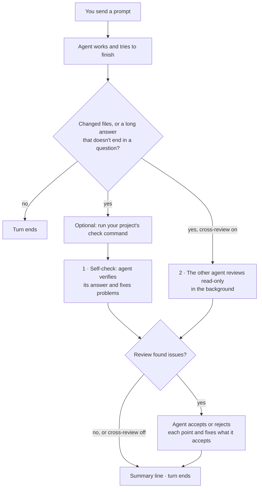

# Power Agents

**Codex and Claude Code check their own work, and each other's, before they
hand it to you.**

[](https://github.com/chrysogonus/power-agents/actions/workflows/checks.yml)
[](LICENSE)


Coding agents often stop as soon as an answer *sounds* right: they report a
fix without re-running the tests, or describe code they never re-read. Power
Agents adds one hook, the **verify gate**, to both agents. Before a
substantial turn can end, the gate sends the agent back once to check its
work against real files and tests. If you want, it also asks the *other*
agent for a second opinion.

## At a Glance

| | Feature | What you get |
| --- | --- | --- |
| ✅ | **Self-check** · on | Before it finishes, the agent re-reads what it changed, runs the checks, and fixes what is wrong. |
| 🔁 | **Cross-review** · opt-in | Codex reviews Claude Code's work and Claude Code reviews Codex's work. The original agent then accepts or rejects each point. |
| 🧾 | **Summary line** | Every checked turn ends with one line saying what was checked, what was fixed, and what is still open. |
| 🧩 | **Optional extras** | Shared coding preferences, 13 skills, status lines, and Codex command rules. [Pick only what you want](#optional-components). |

## Quick Start

```bash
git clone https://github.com/chrysogonus/power-agents.git ~/power-agents
cd ~/power-agents
make install
```

1. **Restart** any open Codex or Claude Code sessions.
2. **Codex only:** in a new session, run `/hooks` and approve the verify-gate
   hooks. Codex ignores new hooks until you do.
3. **Try it:** ask either agent to change a file and watch the end of the turn.

You need GNU/Linux with Bash 4.4+, git, make, jq, and Python 3; see
[Requirements](#requirements). Power Agents does not install Codex or Claude
Code themselves.

## What a Checked Turn Looks Like

```text
 you    ▸ Add a --dry-run flag to the export script.

 agent  ▸ Added --dry-run to export.py with a test. All tests pass.

          ┄┄ the verify gate sends the agent back once ┄┄

 agent  ▸ Verification: fixed the --help text, which still said --dryrun
          - Re-read export.py: the flag is parsed and skips the write
          - Ran pytest tests/test_export.py: 6 passed
          Open items:
          - Not tested with paths that contain spaces

 verify gate · self-check fixed, edited files · 1 open item
```

The agent's note always starts with `Verification: no issues` or
`Verification: fixed …`. Then it says what it checked and how. It adds
`Open items:` only when something is still open. The last line comes from the
gate itself. With cross-review on, the summary line also reports the review,
for example `cross-review (Codex): accepted 2, rejected 1`.

## How It Works



**1. Self-check (on by default).** The agent is sent back once with a fixed
checklist:

- Verify each claim, code change, and command against something it can check
  now: re-read the changed files, run the tests or linters, and re-check the
  docs. Earlier reasoning doesn't count.
- Look for gaps: edge cases, callers, configs or tests that were not updated,
  unstated assumptions, security impact.
- Fix real problems and keep what holds. Being asked to look again is not a
  reason to change anything.

**2. Cross-review (off by default).** The other vendor's agent gets your
latest request, the session transcript, and the diff of this turn's changes.
It reviews them without changing anything and reports bugs, security issues,
missed requirements, and claims the evidence doesn't support. Models from
different vendors tend to miss different things.
[How the reviewer is restricted →](docs/verify-gate.md#how-the-reviewer-is-restricted)

**When the gate stays out of the way:**

- Short answers and questions back to you are not checked, as long as no
  files changed.
- A turn that only commits work the gate already checked is skipped.
- There are at most two extra passes per turn.
- A reviewer that is missing, fails, or times out is skipped with a notice.
  It never blocks you.

## Is It Worth It?

- 👍 **A push toward evidence.** Claims about code, commands, and test results
  get backed by checks run *now*, not by memory.
- 👍 **A second look at every substantial turn.** Wrong statements, forgotten
  files, and overpromises get another chance to be caught before you act on
  them.
- 👍 **You see what was checked.** You know which parts to double-check
  yourself.
- ⚠️ **It is a prompt, not a guarantee.** The gate cannot confirm that the
  agent really ran the checks, and the agent can still be wrong afterward.
  Review important changes yourself.
- 💸 **It costs time and tokens.** Every qualifying turn gets an extra model
  pass, and cross-review adds a full review by the other agent.
- 🔒 **Cross-review leaves the vendor.** Your transcript and diff go to the
  *other* vendor. Leave it off for work that must stay with one vendor.

<details>
<summary><b>Measured so far</b> (October 2026, one user, Claude Code only)</summary>

Over 20 sessions in two days, 94 turns were self-checked. In 41 of them (44%),
the agent reported fixing something. Of 43 cross-reviews by Codex, 23 (53%)
reported issues.

These numbers count how often the gate led to a change, not whether the final
answers got better. To measure that, run the randomized
[experiment or the gate-on/off benchmark](docs/experiment.md). To see your own
numbers, run `python3 ~/.agents/hooks/verify-gate.py stats`.

</details>

## Optional Components

The first `make install` installs only the verify gate. Everything else is off
until you select it:

| Component | What it means for you |
| --- | --- |
| `instructions` | Both agents follow the same personal coding preferences in every project ([`instructions/general-global.md`](instructions/general-global.md)). |
| `skills` | 13 ready-made guides for specific jobs, such as minimal bug fixes, code reviews, React, Postgres, security, and UI design. [Browse the skills →](skills/README.md) |
| `statusline` | Both agents show the project, the model, the context used, and usage limits at the bottom of the terminal. |
| `codex-rules` | Codex asks before running some test commands: `.venv/bin/pytest`, `python -m pytest`, and `.venv/bin/python -m pytest`. |

Pass a comma-separated list, or `all` or `none`:

```bash
./install.sh --components skills,instructions
./install.sh --components all
```

The installer saves your choice in `~/.config/power-agents/components`, so
later runs of `make install` and `make sync` keep it. If you leave a component
out of a new list, the installer removes what it added for that component and
nothing else. [Details →](docs/installation.md#choosing-components)

With the `skills` component, ask for a skill by name, or just describe the
task and let the agent choose one:

| Agent | Example prompt |
| --- | --- |
| Codex | `$ponytail fix this bug using the smallest suitable change` |
| Claude Code | `/ponytail fix this bug using the smallest suitable change` |

## Turning Cross-Review On or Off

Cross-review is **off** by default. When it is on, Claude Code's work goes to
Codex (OpenAI) and Codex's work goes to Claude Code (Anthropic). By default,
only qualifying turns that changed files are reviewed.

```bash
python3 ~/.agents/hooks/verify-gate.py cross-review on    # or: off, status
```

To turn cross-review on or off for one repository only, or to have the gate
run your test command before each self-check, use
[per-project settings](docs/verify-gate.md#per-project-settings).

## Everyday Controls

All of these are `python3 ~/.agents/hooks/verify-gate.py <command>`:

| Command | What it does |
| --- | --- |
| `cross-review on\|off\|status` | Turns cross-review on or off for all sessions, or shows the global setting. |
| `doctor` | Checks that both agents run the gate and, when cross-review is on, that the reviewer CLIs are ready. |
| `review --agent claude\|codex` | Has the *other* agent review your uncommitted changes now. Add `--base main` to include commits and `--focus TEXT` to steer it. This always sends the diff to the other vendor, even with cross-review off. |
| `status` / `cancel` | Lists or stops background reviews that are still running. |
| `stats` | Shows how often the gate ran, what it fixed, and what it cost. |

To turn the gate off for one session, start the agent with `VERIFY_GATE=0`.
All options are in the [verify gate guide](docs/verify-gate.md#controls).

## Make Commands

Run these from your checkout. `make` on its own lists them.

| Command | What it does |
| --- | --- |
| `make install` | Install or update the verify gate and your saved components for both agents. |
| `make sync` | Pull upstream updates and reinstall. [Details](docs/installation.md#syncing) |
| `make uninstall` | Remove the verify gate and everything the installer added. Your other settings stay. [Details](docs/installation.md#uninstall) |
| `make check` | Run all checks and tests on your working copy. |
| `make test` | Run only the behavioral tests. |
| `make ci` | Run the same checks as GitHub Actions. |
| `make skills-outdated` | Check the imported skills against their upstream repositories. Needs an authenticated `gh`. |
| `make eval EVAL_ARGS="--skill ponytail"` | Measure how well skills are chosen and followed. **Uses paid API calls.** [Details](docs/development.md#behavioral-skill-evaluations) |
| `make coding-eval CODING_EVAL_ARGS="--agent claude --model MODEL"` | Plan coding-outcome trials. Add `--execute` to run them, which is **paid**. [Details](docs/coding-evaluations.md) |

## What the Installer Changes

```text
  this repository                       your home directory
  ───────────────                       ───────────────────
  Always installed
  hooks/verify-gate.py           ──▶ ~/.agents/hooks/verify-gate.py
  settings/*/hooks.json          ──▶ merged into ~/.claude/settings.json,
                                     ~/.codex/hooks.json

  Optional components
  instructions/general-global.md ──▶ ~/.codex/AGENTS.md, ~/.claude/CLAUDE.md
  skills/<name>/                 ──▶ ~/.agents/skills/<name>, ~/.claude/skills/<name>
  settings/ (status lines)       ──▶ ~/.claude/statusline-command.sh, merged into
                                     ~/.claude/settings.json, ~/.codex/config.toml
  policies/codex/shared.rules    ──▶ ~/.codex/rules/shared.rules

  Installer state                    ~/.config/power-agents/
```

If `CODEX_HOME` or `CLAUDE_CONFIG_DIR` is set, those directories take the
place of `~/.codex` and `~/.claude`.

- 🔗 **Most files are linked, not copied.** They are symlinks back to this
  checkout, so an edit here reaches both agents right away. **Keep the
  checkout where it is:** moving or deleting it breaks your agents' setup.
- 🧷 **Settings files are merged, not replaced.** The installer changes only
  the keys it manages. The exception is the `statusline` component: it
  **replaces** your status-line setting in each agent (Claude Code's
  `statusLine`, and Codex's `tui.status_line` and `tui.status_line_use_colors`)
  and keeps no copy of the old value. Back those up first if you customized
  them.
- 🛑 **Nothing of yours is overwritten.** If a file, folder, or skill already
  exists where a link should go, the installer stops and tells you. If an
  install fails partway, it rolls back its changes.
  [Resolving a conflict →](docs/installation.md#resolving-an-installation-conflict)
- ♻️ **It is safe to rerun.** Running `make install` again brings everything
  up to date.

Every installed path is listed in the
[installation reference](docs/installation.md#installed-paths).

## Installation

### Requirements

| To… | You need |
| --- | --- |
| Install and use | GNU/Linux, Bash 4.4 or newer, GNU coreutils, `git`, `make`, `jq`, `python3` |
| Use the `statusline` component | `tomlkit` (`python3-tomlkit`) |
| Use the `skills` component | PyYAML (`python3-yaml`) |
| Read compressed Codex transcripts | `zstd`, optional |
| Run `make check`, `make test`, `make ci` | all of the above, plus `shellcheck`, `tomlkit`, and PyYAML |

macOS is not supported yet. On Debian or Ubuntu:

```bash
sudo apt-get update
sudo apt-get install bash coreutils git make jq python3
```

### Steps

1. Clone the repository anywhere you like and run `make install`, as in the
   [Quick Start](#quick-start). The installer prints `Done.` and lists what
   it installed. To add [components](#optional-components), run
   `./install.sh --components LIST` instead.
2. Restart your agent sessions. In Codex, run `/hooks` and approve the
   verify-gate hooks.
3. Check the setup:

   ```bash
   python3 ~/.agents/hooks/verify-gate.py doctor
   ```

## Making It Your Own

Always edit files **in this repository**, never the installed copies. Then
run `make install` and restart your agent sessions.

| To change… | Edit… |
| --- | --- |
| The self-check and cross-review behavior | [`hooks/verify-gate.py`](hooks/verify-gate.py) ([guide](docs/verify-gate.md)) |
| Gate settings or a check command for one repository | `~/.config/power-agents/projects.json` ([format](docs/verify-gate.md#per-project-settings)) |
| Which optional components are installed | Run `./install.sh --components LIST` |
| Your coding preferences for all projects | [`instructions/general-global.md`](instructions/general-global.md) |
| A skill, or add a new one | `skills/<name>/SKILL.md` ([skill format](skills/README.md#skill-format)) |
| Codex command rules | [`policies/codex/shared.rules`](policies/codex/shared.rules) |
| Codex status line | [`settings/codex/tui.toml`](settings/codex/tui.toml) |
| Claude Code status line | [`settings/claude/statusline-command.sh`](settings/claude/statusline-command.sh) |

## Quality Checks

Before you commit, run `make check`. Before you push, run `make ci`. Both need
the development tools from [Requirements](#requirements). On Debian or
Ubuntu:

```bash
sudo apt-get install git make jq python3 python3-tomlkit python3-yaml shellcheck
```

What the checks cover is described in the
[development guide](docs/development.md#quality-checks).

## Repository Layout

```text
power-agents/
├── hooks/          The verify gate (self-check and cross-review)
├── settings/       Agent-specific settings: hook entries and status lines
├── instructions/   Coding preferences installed for both agents
├── skills/         One folder per skill, each with a SKILL.md
├── policies/       Codex command approval rules
├── install.sh      The installer (run through `make install`)
├── sync.sh         Fast-forward updater (run through `make sync`)
├── scripts/        Checks, settings merging, and evaluation runners
├── tests/          Isolated tests that never touch your real setup
├── evals/          Tasks for the coding-outcome evaluations
├── docs/           Detailed reference documentation
└── research/       Notes on upstream skills that were considered
```

`AGENTS.md` at the root holds the instructions for agents working on *this*
repository. It is not installed globally.

## Further Reading

- [Installation reference](docs/installation.md): every installed path, merge
  rules, conflicts, sync, and uninstall
- [Verify gate and cross-review](docs/verify-gate.md): when it runs, controls,
  per-project settings, cost, and privacy
- [Measuring the verify gate](docs/experiment.md): the randomized experiment,
  blinded audits, export, and the controlled benchmark
- [Skills](skills/README.md): the full inventory and how to write a skill
- [Development and evaluations](docs/development.md): checks, adding skills,
  and paid skill evaluations
- [Coding-outcome evaluations](docs/coding-evaluations.md): isolated coding
  trials with instructions or the gate on and off
- [First-phase modernization](docs/modernization.md): a historical record of
  the evaluation rework
- [Contributing](CONTRIBUTING.md), [Security Policy](SECURITY.md), and
  [Code of Conduct](CODE_OF_CONDUCT.md)

## License

Original repository content is available under the [MIT License](LICENSE).
Third-party components keep their own terms and attribution; see
[Third-Party Notices](THIRD_PARTY_NOTICES.md).
