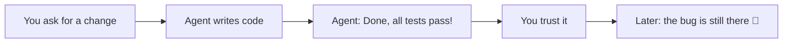
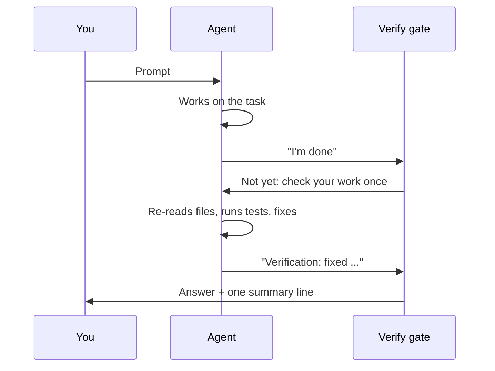
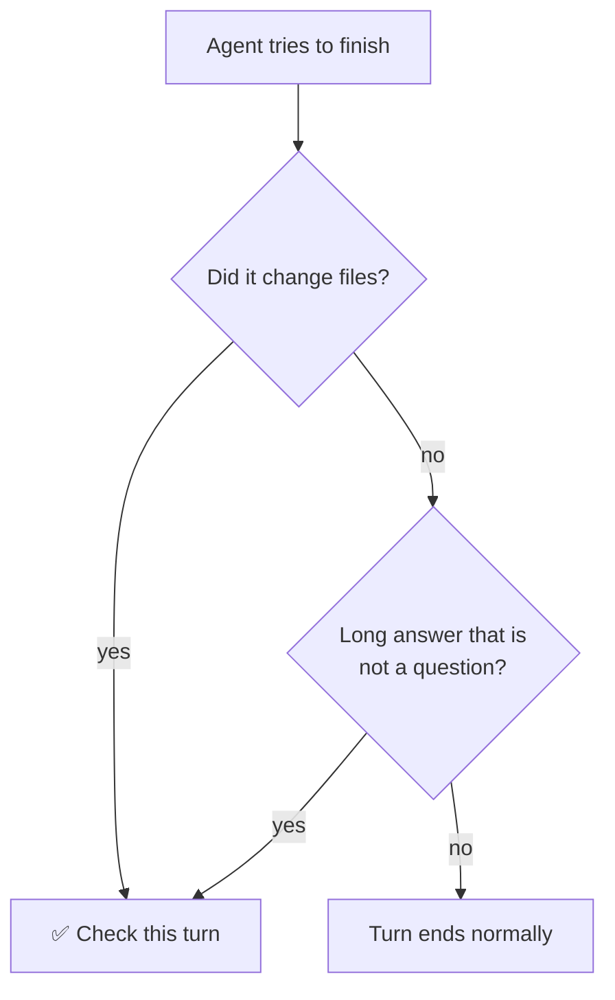
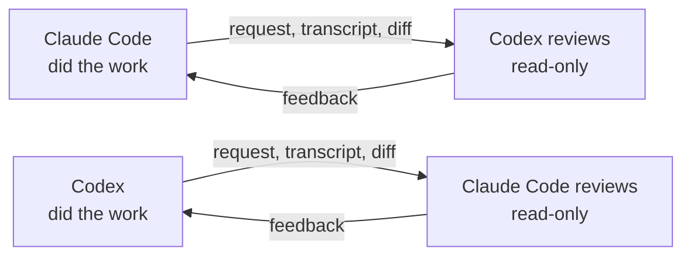
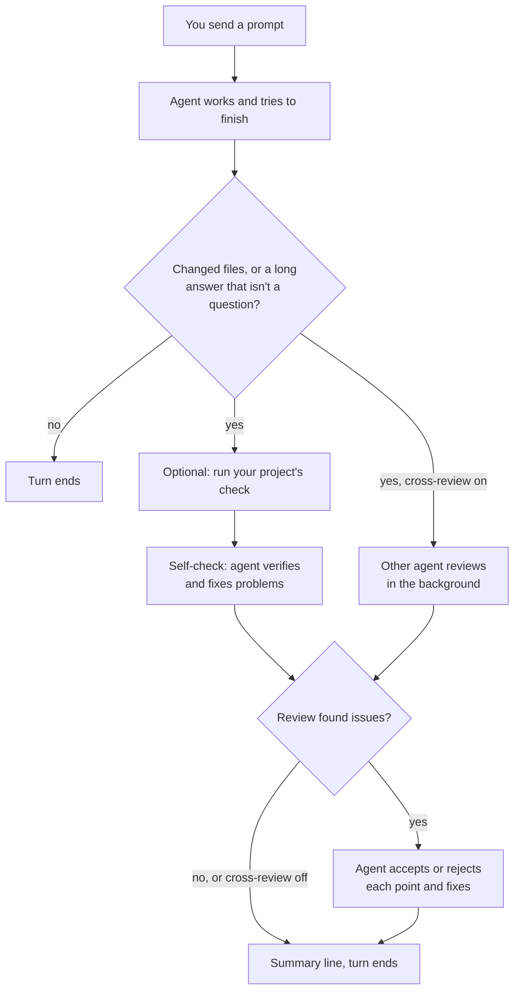
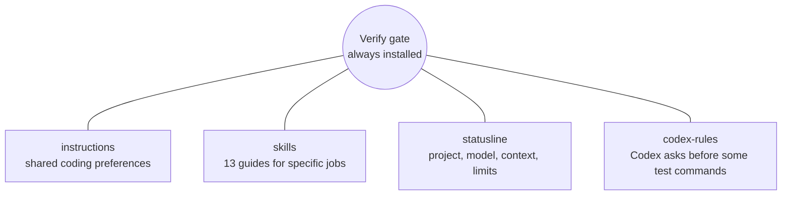
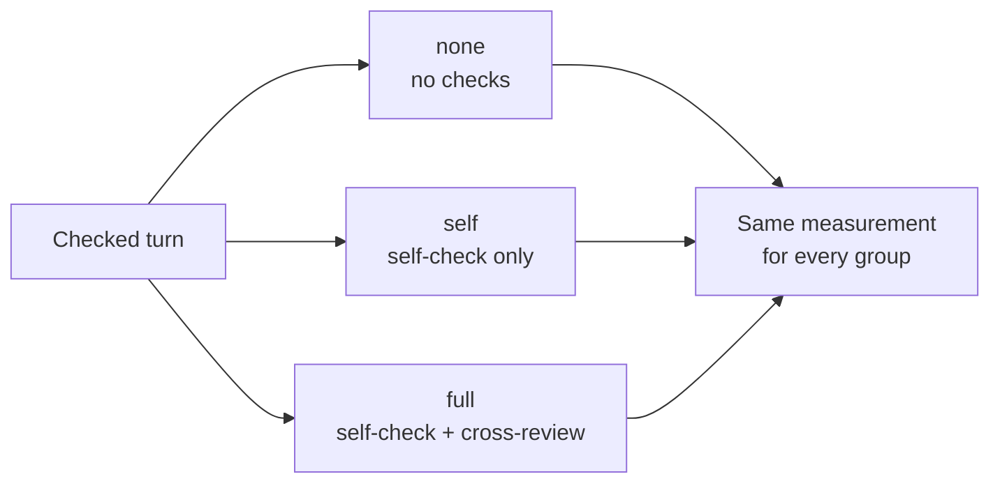

# Power Agents in Pictures

A short, visual tour of what this repository does and how it works. Each
section is one idea with one picture, so it maps well onto slides. The
[5-minute talk outline](#5-minute-talk-outline) at the end puts them in order.
For the full details, follow the links to the reference docs.

## 1. In One Sentence

**Codex and Claude Code check their own work, and each other's, before they
hand it to you.**

```text
  Without Power Agents                 With Power Agents

  you   ▸ fix the bug                  you   ▸ fix the bug
  agent ▸ Done ✅ tests pass           agent ▸ Done ✅ tests pass
          (did it run them? 🤷)                 ┄┄ gate: check once more ┄┄
                                       agent ▸ re-read the file, ran the
                                               tests, fixed a typo
                                       verify gate · self-check fixed
```

> **Say it in one line:** It adds a "check your work" step to coding agents.

## 2. The Problem

Coding agents often stop as soon as an answer *sounds* right. They say the
tests pass without running them again, or describe code they never re-read.
You only find out later.



> **Say it in one line:** Agents sound sure even when they did not check.

## 3. The Idea: a Gate Before "Done"

Power Agents adds one small program, the **verify gate**
([`hooks/verify-gate.py`](../hooks/verify-gate.py)), to both agents. Agents
let you plug in programs like this, called *hooks*, that run at fixed moments.
The gate runs when you send a prompt and when the agent tries to stop. If the
turn was real work, the gate sends the agent back **once** to check itself.



> **Say it in one line:** Before the agent may finish, the gate says "prove
> it" once.

## 4. When Does the Gate Step In?

Not every turn needs a check. The gate only steps in when the agent changed
files, or wrote a long answer (600 characters or more) that is not a question
back to you.



It also stays out of the way:

- 💬 Short answers and questions back to you are not checked.
- 📦 A turn that only commits work that was already checked is skipped.
- 🔢 At most two extra passes per turn, never a loop.
- 🚦 If a reviewer is missing, fails, or is too slow, it is skipped with a
  note. It never blocks you.

> **Say it in one line:** It checks real work and leaves small talk alone.

## 5. Pass 1: Self-Check (On by Default)

The agent gets the same short checklist every time:

```text
  ┌──────────────────────────────────────────────────────────────┐
  │  SELF-CHECK                                                  │
  │                                                              │
  │  ☐ 1. Verify   Check every claim against something real NOW: │
  │                re-read changed files, run tests and linters. │
  │                Earlier reasoning doesn't count.              │
  │  ☐ 2. Gaps     Edge cases, callers, configs, tests not       │
  │                updated, hidden assumptions, security.        │
  │  ☐ 3. Fix      Fix real problems. Keep what holds. Being     │
  │                asked again is no reason to change things.    │
  └──────────────────────────────────────────────────────────────┘
```

Optional: you can give a repository a **check command**, such as
`./scripts/check.sh`. The gate runs it first and tells the agent whether it
passed. [Per-project settings →](verify-gate.md#per-project-settings)

> **Say it in one line:** The agent must look at the evidence again, not at
> its memory.

## 6. Pass 2: Cross-Review (Opt-In)

When you turn it on, the **other** company's agent reviews the work. Models
from different vendors tend to miss different things.



How it works, step by step:

1. The reviewer starts in the background while the agent does its
   self-check, so you wait less.
2. It gets your request, the session transcript, and the changes of this
   turn. Secrets like API keys are replaced with `[REDACTED]` first.
3. It can only read, never change anything.
   [How the reviewer is restricted →](verify-gate.md#how-the-reviewer-is-restricted)
4. If it finds issues, the original agent **accepts or rejects each point**
   and fixes what it accepts.

> ⚠️ **Privacy:** with cross-review on, your transcript and changes go to the
> *other* vendor (Claude Code work goes to OpenAI, Codex work goes to
> Anthropic). That is why it is off by default.

> **Say it in one line:** Optionally, a second agent from another vendor
> gives a second opinion.

## 7. What You See at the End

Every checked turn ends with a short report from the agent and one line from
the gate:

```text
 you    ▸ Add a --dry-run flag to the export script.

 agent  ▸ Added --dry-run to export.py with a test. All tests pass.

          ┄┄ the verify gate sends the agent back once ┄┄

 agent  ▸ Verification: fixed the --help text, which still said --dryrun
          - Re-read export.py: the flag is parsed and skips the write
          - Ran pytest tests/test_export.py: 6 passed
          Open items:
          - Not tested with paths that contain spaces

 verify gate · self-check fixed, edited files · 1 open item
```

The summary line, piece by piece (each part is joined with ` · ` on one line):

```text
 verify gate
   ├─ check passed (12s)                            ← your project's check (optional)
   ├─ self-check fixed                              ← what the self-check found
   ├─ cross-review (Codex): accepted 2, rejected 1  ← what it did with the other agent's points
   └─ 1 open item                                   ← what is still left to do
```

> **Say it in one line:** You see at a glance what was checked and what is
> still open.

## 8. The Whole Picture



> **Say it in one line:** Check yourself, optionally get a second opinion,
> then report.

## 9. What Gets Installed

One command, `make install`, installs the verify gate. Everything else is an
optional extra you pick yourself.



Where things go:

```text
  this repository                       your home directory
  ───────────────                       ───────────────────
  hooks/verify-gate.py          ──🔗──▶ ~/.agents/hooks/verify-gate.py
  settings/*/hooks.json         ──🧷──▶ merged into each agent's settings
  instructions/, skills/, ...   ──🔗──▶ only if you picked that extra

  🔗 = linked back to this folder, so edits here apply right away
  🧷 = merged: only the keys it manages change, the rest stays yours
```

Good to know:

- 🛑 It never overwrites your files. If something is in the way, it stops and
  tells you, and a failed install rolls back.
- ♻️ It is safe to run again. Running it again brings everything up to date.
- 📁 Keep the checkout where it is. The links point back to it.

Getting started takes three steps: `make install`, restart your agents, and
in Codex approve the hooks with `/hooks`.
[Choosing components →](installation.md#choosing-components)

> **Say it in one line:** One command, the gate by default, extras only if
> you want them.

## 10. Everyday Controls

All of these are `python3 ~/.agents/hooks/verify-gate.py <command>`:

| Command | What it does |
| --- | --- |
| `cross-review on` / `off` | Turn the second opinion on or off. |
| `doctor` | Check that everything is set up correctly. |
| `review --agent claude` | Ask the other agent to review your changes right now. |
| `stats` | See how often the gate ran, what it fixed, and what it cost. |

To switch the gate off for one session, start the agent with `VERIFY_GATE=0`.
[All controls →](verify-gate.md#controls)

## 11. Honest Trade-Offs

| 👍 What you gain | ⚠️ What it costs |
| --- | --- |
| Claims are backed by checks run *now*, not by memory. | It is a prompt, not a guarantee. The gate cannot prove the agent really ran the checks. |
| Every real piece of work gets a second look. | Each checked turn costs an extra model pass: more time and tokens. |
| You see what was checked, so you know what to double-check yourself. | Cross-review sends your data to the other vendor. |

> **Say it in one line:** Cheap insurance, not a replacement for your own
> review.

## 12. Does It Help? Early Numbers

From one user, using Claude Code only, over 20 sessions in two days in
October 2026:

```text
  Self-checks       94 turns   ███████████████░░░░░░░░░░░░░░░░░░░  41 fixed something  (44%)
  Cross-reviews     43 reviews ██████████████████░░░░░░░░░░░░░░░░  23 found issues     (53%)
```

These numbers count how often the gate led to a change, not whether the
answers got better. To measure that, the repository includes a randomized
experiment. It assigns each checked turn at random to one of three groups and
compares the results:



[Measuring the verify gate →](experiment.md)

> **Say it in one line:** In about half of the checked turns, the extra look
> led to a fix; a proper experiment is built in to test if that matters.

## 5-Minute Talk Outline

| Time | Topic | Sections | Key point |
| --- | --- | --- | --- |
| 0:00 | Hook | 1, 2 | "Agents say *done* even when they didn't check." |
| 0:45 | The idea | 3, 4 | One gate before "done", only for real work. |
| 1:45 | Self-check | 5 | Look at the evidence again, not at memory. |
| 2:30 | Cross-review | 6 | A second opinion from another vendor, opt-in. |
| 3:15 | What you see | 7 | One summary line: checked, fixed, still open. |
| 3:45 | Setup | 9 | `make install`, gate by default, extras if wanted. |
| 4:15 | Trade-offs and numbers | 11, 12 | ~44% of checks fixed something; it costs tokens. |
| 4:45 | Close | — | "Make agents prove it before they hand it over." |

Tips: show the picture in [section 8](#8-the-whole-picture) as your one
summary slide, and do a live demo with [section 7](#7-what-you-see-at-the-end)
if you have time: ask an agent to change a file and watch the end of the turn.

## Glossary

| Word | Plain meaning |
| --- | --- |
| **Agent** | An AI coding assistant such as Codex (by OpenAI) or Claude Code (by Anthropic). |
| **Turn** | One round: you send a prompt, the agent works and answers. |
| **Hook** | A small program the agent runs at fixed moments, for example when it tries to stop. |
| **Verify gate** | This repository's hook. It sends the agent back once to check its work. |
| **Self-check** | The agent checks its own work against real files and tests. |
| **Cross-review** | The other vendor's agent reviews the work, read-only. |
| **Open items** | Things the agent says are still unchecked or unfinished. |
| **Component** | An optional extra the installer can add, such as skills. |
| **Skill** | A ready-made guide that tells an agent how to do one kind of job well. |
| **Symlink** | A link to a file in another place, like a shortcut. |

## Where to Go Next

- [README](../README.md): the project front page
- [Verify gate and cross-review](verify-gate.md): every rule and setting
- [Installation reference](installation.md): what is installed where
- [Measuring the verify gate](experiment.md): the experiment and benchmark
- [Skills](../skills/README.md): all 13 skills
